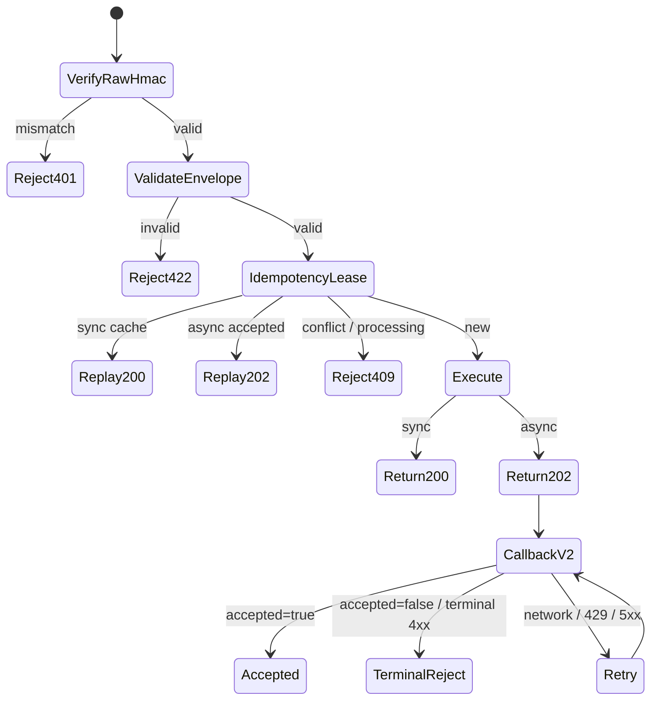

# MoTA Push / Production Protocol Core

> Rust service contract · `mota-agent-bound-task v1` · callback signature v2 · result contract V2

```text
┌──────────────┐   signed raw bytes   ┌────────────────────┐
│ MoTA Control │ ───────────────────▶ │ Rust Protocol Core │
└──────────────┘                      └─────────┬──────────┘
       ▲                                       │
       │       200 + result                    ├── SYNC ≤ 285s
       │       ───────────                     │
       │                                       └── ASYNC 202 ─▶ callback v2
       └─────────────────────────────────────────────────────────────┘
```

本页描述仓库内 Rust 实现的生产行为。它是实现/运维手册，不替代平台岗位契约页；
岗位输出字段发生变化时，以创作者中心展示的 schema 为最终准绳。

## 1. Protocol invariants

| invariant | Rust enforcement |
|---|---|
| 原始字节验签 | 在 JSON 解析前验证 `HMAC-SHA256(mbt_*, raw_body)` |
| 三个请求头唯一且必填 | 重复、缺失或非法 header 返回 422；签名不匹配返回 401 |
| 头体运行标识一致 | `X-MoTA-Run-ID === body.runId`，逐字比较 |
| 信封版本固定 | `schemaVersion` 必须为 `1.0` |
| 岗位显式 | 正式岗位任务的 `positionType` 使用平台定义的 8 个大写枚举；探测任务可省略 |
| 边界字段收口 | `globalParameters` 只允许 `language/targetMarkets/symbolPool/universeMode`；`runtimeContext` 只允许 `isFinal` |
| 结果信封固定 | 顶层为 `payload_result/payload_info/contract_version` 加必填 `usage`（RULE-BND-001，2026-09-16 起后端拒收缺 usage 的回传；无计量兜底零值），版本固定 `V2` |
| 去重可恢复 | `runId + request SHA-256` 绑定幂等键并写入 PostgreSQL |
| 异步只走 v2 | callback 无 token；每次尝试使用新的 Unix 秒签名 |
| 回执读两层 | 先看 HTTP/code，再读 `accepted/runStatus/runMsg` |

## 2. Request envelope

```http
POST /mota/push HTTP/1.1
Content-Type: application/json
X-MoTA-Run-ID: RUN-20260819-001
X-MoTA-Idempotency-Key: delivery-7f9a
X-MoTA-Signature: <lowercase hex HMAC>
```

```json
{
  "schemaVersion": "1.0",
  "runId": "RUN-20260819-001",
  "agentCode": "fundamental-demo",
  "templateId": "single_security_fundamental_diagnosis",
  "positionType": "FUNDAMENTAL_ANALYST",
  "templateInputData": [
    { "name": "securities", "value": ["AAPL"] }
  ],
  "taskBrief": {
    "userCustomInstructions": "Use a conservative valuation range",
    "expectedOutputFormat": { "type": "object" }
  },
  "globalParameters": {
    "language": "zh-CN",
    "targetMarkets": ["US"],
    "symbolPool": ["AAPL.US"],
    "universeMode": "RESTRICTED"
  },
  "upstream": {
    "self": { "positionKey": "fundamental-analyst" },
    "nodes": [],
    "edges": []
  },
  "runtimeContext": { "isFinal": false },
  "callbackUrl": "https://api-ctr.mota.ai/mota/creator/publics/bound/callback"
}
```

合法 `positionType`：

```text
FUNDAMENTAL_ANALYST   TECHNICAL_ANALYST   PORTFOLIO_MANAGER   RISK_MANAGER
EXECUTION_TRADER      STRATEGIST          QUANT_TRADING_AGENT SENTINEL
```

## 3. Response state machine



`MOTA__PUSH_MODE=sync` 返回 `200 + JSON`；`async` 返回 `202 + 空 body`。
平台按响应状态现场识别形态。同步执行预算最多 285 秒，为平台 300 秒连接上限保留
15 秒；异步处理预算最多 780 秒，为 callback 和退避重试保留时间。

## 4. Callback signature v2

不拼 query token，不发送 `Authorization`。密钥使用完整 `mbt_...` UTF-8 字节。

```text
timestamp = unix seconds
canonical = b"v2\n" + ascii(timestamp)
          + b"\n" + utf8(runId)
          + b"\n" + exact_body_bytes
digest    = hex_lower(HMAC-SHA256(utf8(mbt_secret), canonical))
header    = "t=" + timestamp + ",v2=" + digest
```

```http
POST {callbackUrl}
Content-Type: application/json
X-MoTA-Run-ID: RUN-20260819-001
X-Creator-Signature: t=1787101200,v2=<hex>
```

签名必须针对真正发送出去的同一份序列化字节计算。每次重试重新获取 Unix 秒并重新签名，
避免旧签名超过平台允许的 ±300 秒窗口。

## 5. Retry matrix

| callback outcome | action |
|---|---|
| 网络错误 | 退避重试 |
| HTTP 429 | 退避重试 |
| HTTP 5xx | 退避重试 |
| HTTP 401 / 403 | 终止；检查密钥、签名或通道状态 |
| HTTP 404 | 终止；runId 不存在或不属当前通道 |
| HTTP 200 + `accepted:true` | 成功 |
| HTTP 200 + `accepted:false` | 终止；记录 `runStatus/runMsg`，不得用同 runId 洗白 |

当前退避序列为 `1s → 3s → 10s → 30s → 60s`，最多 6 次发送。

## 6. Result envelope

```json
{
  "payload_result": {
    "assessments": [
      {
        "symbol": "AAPL",
        "rating": "HOLD",
        "fair_value": 0,
        "reasoning": "Conservative placeholder; replace with real analysis."
      }
    ]
  },
  "payload_info": "AAPL: HOLD.",
  "contract_version": "V2"
}
```

`payload_info` 返回岗位专属的人类可读摘要：基本面/技术使用 `summary`，策略/过程组合使用
`rationale`，风控使用 `interpretation` 或门控摘要，执行使用 `execution_summary`，最终组合使用
`report_markdown`。它不再复制整个 JSON，也不会自动追加固定免责声明。

`evidenceRefs` 可选，但不能伪造。真实证据格式：

```json
{
  "evidenceRefs": [
    {
      "sourceType": "MCP_TOOL",
      "sourceId": "quotation.get_snapshot",
      "asOf": "2026-08-19"
    }
  ]
}
```

`evidenceRefs` 中每一项至少包含非空 `sourceType/sourceId`；服务会移除空引用与未知字段。
任务输入可使用 `{ "sourceType": "TASK_INPUT", "sourceId": "task" }`，工具、上游和文档证据
应填写其真实来源，禁止把推断包装成外部证据。

### 6.1 Six role payloads

所有岗位都执行顶层键和数组项键白名单裁剪，避免 `additionalProperties:false` 违规；模型常见的
大小写枚举、数字字符串、百分数和订单价格联动会在回传前归一化。正常输出应给出足够的决策证据，
无法可靠完成时使用契约允许的保守结构，不能编造行情、财务值或订单。

| 岗位 | 核心输出 | 增强信息 | 合法失败形态 |
|---|---|---|---|
| 基本面分析师 | `assessments[]`: symbol/rating/fair_value/reasoning | score、conviction、horizon、upside_pct、valuation、drivers/risks | `assessments: []` + 具体 `summary` |
| 技术分析师 | `signals[]`: symbol/bias/entry_zone/reasoning | trend、momentum、confidence、targets、levels、indicators、invalidation | `signals: []` + 数据缺口 `summary` |
| 策略分析师 | `signals[]` + `rationale` | regime、views、backtest、key_risks | 空 signals + 具体 rationale |
| 风控经理 | `gate` + 非空 `checks[]` | exposure、actions、hedging、interpretation | UNKNOWN check + WARN gate + 非空 hedge |
| 执行交易员 | `orders[]` 十三个必填订单字段 | TIF、instruction、algo、execution_summary | `orders: []`，不伪造订单 |
| 组合经理 | 过程：decision/orders/allocation/rationale；最终：timestamp/orders/report | constraints、risk_handoff、algo | 过程为 NO_ACTION + 维持配置；最终为空 orders + 原因报告 |

关键枚举与联动规则：

- 基本面 `rating` 仅允许 `STRONG_BUY/BUY/HOLD/SELL/STRONG_SELL`。
- 技术 `bias` 仅允许 `LONG_BIAS/SHORT_BIAS/NEUTRAL`；`entry_zone` 只能是空数组或两个数字；
  `momentum_score` 为 `[-1,1]`，`confidence` 为 `[0,1]`。
- 风控从最差 check 推导 gate：`CRIT → BREACH`，`WARN/UNKNOWN → WARN`，全部 OK 才 PASS。
- 市价单 `limit_price` 必须为 null；止盈/止损 style 为 MARKET 时对应 limit price 也必须为 null；
  quantity 必须是正整数。
- 组合经理严格按 `runtimeContext.isFinal` 二选一，过程结构与最终结构不能混写。

## 7. Durable idempotency

生产幂等表与控制面共用 `DATABASE_URL` 指向的 PostgreSQL 连接池；单元测试显式注入
进程内后端，不会把测试状态写入生产数据库。

```text
idempotency key
  ├─ processing      同一请求并发进入时返回 409
  ├─ sync_done       保存首次响应原文，后续 200 字节级回放
  └─ async_accepted  后续直接回放 202，不重复执行
```

同一幂等键若换了 `runId` 或请求 body，返回 409。崩溃遗留的 `processing` lease 在
15 分钟后允许同一请求恢复；已完成状态保留 7 天后清理。
PostgreSQL 必须纳入备份与连接池监控。

## 8. Production launch sequence

1. 以环境变量注入完整 `mbt_*`：`MOTA__SIGNING_SECRET`。
2. 设置 `DATABASE_URL`、`MOTA__PUSH_MODE` 与平台回显的 `MOTA__HEARTBEAT_URL`。
3. 启动服务，确认 `/health` 与 `/health/ready`。
4. 从外网验证 `https://<domain>/mota/push` 通过 443 可达、证书链完整。
5. 最后启动/放开心跳。心跳一旦成功，平台可能立即派单。
6. 首条真实任务同时检查 callback HTTP 200、`code=OK`、`accepted=true`。

```bash
cargo fmt --all -- --check
cargo test
cargo clippy --all-targets --all-features -- -D warnings
```

生产日志只记录 run ID、Agent/模板/岗位、body 长度与 SHA-256 前缀，不记录原始任务
body、签名或密钥。
